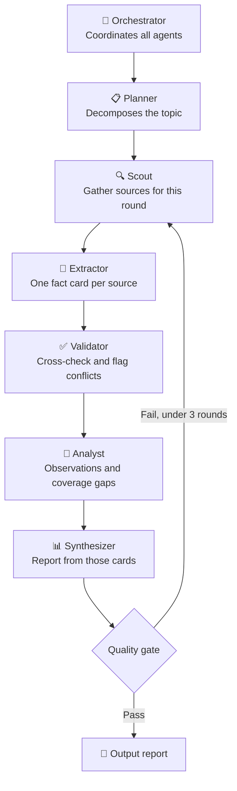

# IdeaScout · 研究 Agent 群

> One question, six experts, one trusted report.
> 一个问题，六个专家，一份可信任的研究报告。

IdeaScout is a small multi-agent research skill. [`SKILL.md`](SKILL.md) is the
workflow a coding agent follows. [`scripts/research_agent.py`](scripts/research_agent.py)
is an offline reference demo of that loop and of the confidence formula.

The demo walks simulated source cards offline, with no model call, so the
scoring rules and the Deep Dive stop conditions can be run and tested with the
Python standard library.

## Architecture



The gate stays closed until all of these are true:

- confidence score is at least 80
- fewer than 2 sub-questions still lack a second source
- no contradiction is unresolved
- no fact is older than 90 days

The loop stops after 3 rounds even if the gate is still closed.

## Confidence score

```
score = source trust × 30% + timeliness × 20% + cross-validation × 30% + consistency × 20%
```

Each term is rounded to one decimal before weighting. The demo prints that
arithmetic so the total can be checked by hand.

| Source type | Trust |
| --- | --- |
| Official / primary | 100 |
| Professional media | 80 |
| Community / hands-on | 60 |
| Blog / self-media | 40 |
| Anonymous or unknown | 20 |

Timeliness starts at 100 and loses 0.5 points per day of source age, clamped to
0–100. Cross-validation is the share of facts that have two or more sources and
do not contradict each other. Consistency is the share of facts with no open
contradiction.

Coverage (how many sub-questions have a second source) is printed next to the
score and can keep the loop running. The weighted formula itself has four terms.

## Quick start

Python 3.11 or newer. No third-party packages. `.python-version` pins 3.12.

```bash
git clone https://github.com/Shanguier/ideascout.git
cd ideascout

python3 scripts/research_agent.py "小米 SU7 vs Model 3 对比分析"
python3 scripts/research_agent.py --help
python3 -m unittest discover -s tests -v
```

If a console is not UTF-8, set `PYTHONIOENCODING=utf-8` first. The script also
asks Python to reconfigure stdout to UTF-8 when the runtime allows it.

[`demo-output.txt`](demo-output.txt) is the stdout of that quick-start command.
For this topic the demo runs three rounds and the score moves
**56.0 → 83.1 → 99.0**. Round 2 is already above 80. Round 3 still runs because
two sub-questions do not yet have a second source. The number describes the
simulated cards, not the products named in the topic.

`--interactive` reads one topic from the prompt, or from stdin when stdin is
piped. `--json` writes the result to stdout and the human log to stderr.
`--max-rounds` caps Deep Dive (default 3).

## What a full agent report contains

`SKILL.md` tells a coding agent to gather real sources and write an executive
summary, findings, a contradiction table, a comparison table, the confidence
breakdown, and next steps. The reference script prints that shape filled with
simulated cards, and it says so in the report.

## Token budget

The local script spends no tokens. A coding agent that follows `SKILL.md` and
does the research itself is a separate cost. These figures are planning guesses
for a single agent run:

| Agent run | Illustrative budget |
| --- | --- |
| One pass through the roles | ~140K tokens |
| One extra Deep Dive round | ~60K tokens |
| Three rounds | ~320K tokens |

## Changelog

### 0.2.0 — 2026-10-22

- Deep Dive rounds add source cards and can pass the quality gate. They no longer repeat one identical failing pass, and the log no longer announces a round that will not run.
- The printed confidence breakdown is the documented formula. The old completeness line moved the wrong direction as gaps increased.
- The planner uses the topic you pass in. The analyst no longer prints canned conclusions, and the script prints the report it says it wrote.
- `--interactive` reads a topic. The flag used to be treated as the topic text.
- Python 3.11+ is declared. Unit tests, GitHub Actions, [CONTRIBUTING.md](CONTRIBUTING.md), and [SECURITY.md](SECURITY.md) are included.
- Removed the unbenchmarked product-comparison table and the daily token totals that read like measured user volume.

## License

MIT. See [LICENSE](LICENSE).

Contributing: [CONTRIBUTING.md](CONTRIBUTING.md). Security: [SECURITY.md](SECURITY.md).
