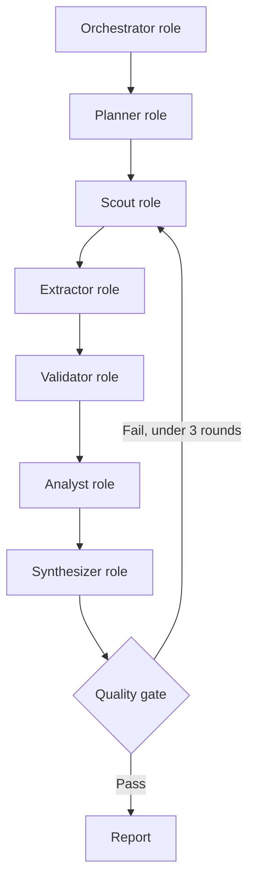

# IdeaScout

> One coding agent, eight roles in series, one sourced report.
> 一个编码代理，按八个角色串行做完研究清单，交出一份带来源的报告。

IdeaScout is a Skill workflow plus an offline demo. [`SKILL.md`](SKILL.md) is
the checklist one coding agent follows. [`scripts/research_agent.py`](scripts/research_agent.py)
walks simulated source cards through that checklist and prints the reference
score. The demo does not call a model and does not search the web, so the
scoring rules and the Deep Dive stop conditions can be tested with the
Python standard library.

It is not a system of independent agents. Older copy said "six experts" and
also drew eight boxes. Those counts did not match. The checklist is eight
roles, played one after another by the same agent:

orchestrator, planner, scout, extractor, validator, analyst, synthesizer,
quality evaluator.

## Architecture



The boxes are steps, not processes. The gate stays closed until all of these
are true:

- the loop check is at least 80
- fewer than 2 sub-questions still lack a second source
- no contradiction is unresolved
- for a current topic, no fact is older than 90 days

The loop stops after 3 rounds even if the gate is still closed.

On a current topic the loop check is the reference score. On a history or
principle topic the loop check drops the timeliness term and rescales the
other three weights. Age is still included in the printed reference score.
It does not by itself start another round, and it is not part of the 80-point
check, so an old primary source does not keep that loop open. Product, price,
news, and release topics stay on the 90-day rule.

## Reference score

The number is a reference for whether to search again. It is not a conclusion
about the topic, and it is not a calibrated probability. One decimal place is
there so a reader can recompute the sum. It is not a claim about measurement
precision.

```
reference = source trust × 30% + timeliness × 20% + multi-source coverage × 30% + consistency × 20%
```

Each term is rounded to one decimal before weighting. The demo prints that
arithmetic.

| Source type | Trust |
| --- | --- |
| Official / primary | 100 |
| Professional media | 80 |
| Community / hands-on | 60 |
| Blog / self-media | 40 |
| Anonymous or unknown | 20 |

Timeliness starts at 100 and loses 0.5 points per day of source age, clamped
to 0–100. Multi-source coverage is the share of facts with two or more
sources. Consistency is the share of facts with no open contradiction. A
contradiction lowers consistency only, so it is not also subtracted from
coverage.

The report used to label the four weights as data integrity, source
credibility, contradiction handling, and freshness. Those names did not match
the formula. The labels above are the ones the script prints.

An open disagreement scores the weakest source type in the group, so a single
official card cannot lift trust to 100 while the conflict is still open. A
side closes the disagreement only when it has at least two cards and its best
source trust is strictly higher than the other side's. One official card is
not enough, and two weaker cards do not outvote one stronger card. A closed
disagreement stays visible in the report as provisional.

How many sub-questions still lack a second source is also a gate: two or more
gaps keep the loop running. That count is not a fifth weight. The percentage
form of the same fact is the multi-source term.

## Quick start

Python 3.11 or newer. No third-party packages. `.python-version` pins 3.12.

```bash
git clone https://github.com/Shanguier/ideascout.git
cd ideascout

python3 scripts/research_agent.py "小米 SU7 vs Model 3 对比分析"
python3 scripts/research_agent.py --help
python3 -m unittest discover -s tests -v
```

If a console is not UTF-8, set `PYTHONIOENCODING=utf-8` first. The script also
asks Python to reconfigure stdout to UTF-8 when the runtime allows it.

[`demo-output.txt`](demo-output.txt) is the stdout of that quick-start command.
For this topic the demo runs three rounds and the reference score moves
**60.8 → 83.1 → 99.0**. Round 2 is already above 80. Round 3 still runs because
two sub-questions do not yet have a second source. The number describes the
simulated cards, not the products named in the topic.

`--interactive` reads one topic from the prompt, or from stdin when stdin is
piped. `--json` writes the result to stdout and the human log to stderr.
`--max-rounds` caps Deep Dive (default 3).

## What a full agent report contains

`SKILL.md` tells a coding agent to gather real sources and write an executive
summary, findings, a contradiction table, a comparison table, the reference
score, and next steps. The reference script prints that shape filled with
simulated cards, and it says so in the report. The skill turns on when someone
asks for IdeaScout or for this workflow. Words such as "research" or "对比"
on their own do not.

## Token budget

The local script spends no tokens. A coding agent that follows `SKILL.md` and
does the research itself is a separate cost. These figures are planning guesses
for that single agent, not measured usage:

| Agent run | Illustrative budget |
| --- | --- |
| One pass through the eight roles | ~140K tokens |
| One extra Deep Dive round | ~60K tokens |
| Three rounds | ~320K tokens |

## Changelog

### 0.3.0 — 2026-10-22

- The skill description no longer treats 研究, 调研, 分析, 对比, or 怎么做 as triggers. It runs when someone asks for IdeaScout or for this workflow.
- Docs say one coding agent plays eight roles in series. The old "six experts" line and the eight-box diagram now describe the same list.
- The printed score is a reference metric for the loop. Report headings use the formula's four terms: source trust, timeliness, multi-source coverage, and consistency.
- Coverage and consistency no longer both go to zero on one contradiction. An open conflict scores the weaker source type. One official card no longer closes a contradiction by itself.
- History and principle topics skip the 90-day hard gate. Their 80-point check ignores timeliness. The printed reference score still includes it.

### 0.2.0 — 2026-10-22

- Deep Dive rounds add source cards and can pass the quality gate. They no longer repeat one identical failing pass, and the log no longer announces a round that will not run.
- The printed confidence breakdown is the documented formula. The old completeness line moved the wrong direction as gaps increased.
- The planner uses the topic you pass in. The analyst no longer prints canned conclusions, and the script prints the report it says it wrote.
- `--interactive` reads a topic. The flag used to be treated as the topic text.
- Python 3.11+ is declared. Unit tests, GitHub Actions, [CONTRIBUTING.md](CONTRIBUTING.md), and [SECURITY.md](SECURITY.md) are included.
- Removed the unbenchmarked product-comparison table and the daily token totals that read like measured user volume.

## License

MIT. See [LICENSE](LICENSE).

Contributing: [CONTRIBUTING.md](CONTRIBUTING.md). Security: [SECURITY.md](SECURITY.md).
